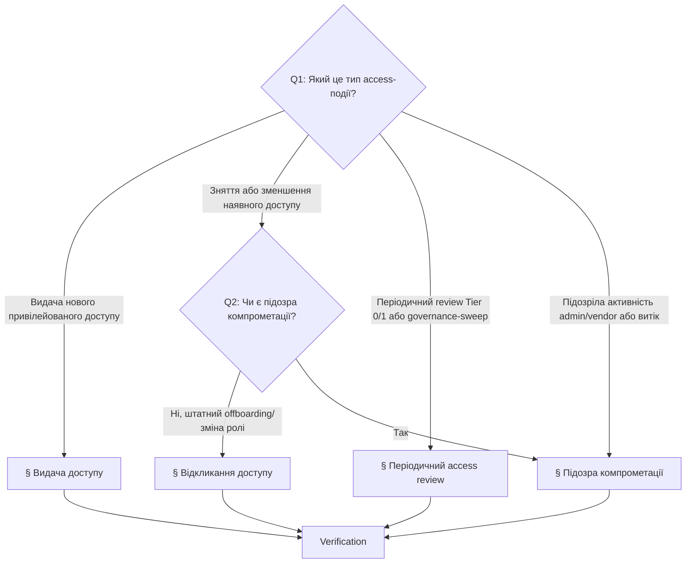

# Playbook: Управління привілейованим доступом

> **Last validated:** 2026-05-05 by @Skords-01. **Next review:** 2026-08-03.
> **Status:** Active

**Trigger:** «Видай / забери доступ» / governance-подія привілейованого доступу в Sergeant — видача нового доступу, відкликання, періодичний review Tier 0/1, або реакція на підозру компрометації акаунта чи токена.

## Owner surface

- Primary surface: privileged access governance і реагування на security-інциденти
- Coupled surfaces: Tier 0/1 vendor-консолі, machine credentials, secrets register
- Governing skill: `sergeant-review-and-merge`
- Secondary skill: `sergeant-deploy-and-observability` (для гілки compromise-response)

## Required context

- Стартуй з `sergeant-start-here`, тоді завантаж `sergeant-review-and-merge` (за замовчуванням) або `sergeant-deploy-and-observability` (коли реагуєш на підозру компрометації).
- Перечитай [access-policy.md](../security/access-policy.md), [access-matrix.md](../security/access-matrix.md) і [secret-ownership-register.md](../security/secret-ownership-register.md).
- Для compromise-подій також перечитай [security-incident-policy.md](../governance/security-incident-policy.md) і тримай напоготові [rotate-secrets.md](./rotate-secrets.md).

## Дерево рішень — який тип access-події?

Якщо подія — суто рантайм-деградація без access-кута, цей playbook не застосовний — використай [investigate-alert.md](./investigate-alert.md) або [hotfix-prod-regression.md](./hotfix-prod-regression.md).

## 1. Видача привілейованого доступу

Для видачі нового привілейованого доступу до задокументованої поверхні Sergeant.

### 1.1 Підтверди валідність запиту

- Назви точну поверхню.
- Назви запитаний tier доступу.
- Зафіксуй бізнес-причину.
- Підтверди, що нижчий tier не вирішує задачу.

### 1.2 Підтверди тип holder-а і ownership

- Класифікуй holder-а: founder, core-engineer, тимчасовий контрактор або machine-account.
- Підтверди, що owner поверхні погоджує видачу.
- Якщо доступ тимчасовий — встанови явний expiry **до** видачі.

### 1.3 Видай мінімально-достатній доступ

- Використовуй vendor-роль або credential-scope, що відповідає мінімальному tier-у.
- Уникни персональної admin-ескалації, коли read-only або scoped project access достатньо.
- Не створюй незадокументованих shared-акаунтів.

### 1.4 Зафіксуй видачу

- Онови access-нотатку, тікет або PR, додавши: поверхня, holder, tier, owner, причина, expiry (якщо тимчасовий).

## 2. Відкликання привілейованого доступу

Для offboarding-у, зменшення ролі, expired contractor-доступу або рішення, що актор більше не потребує привілейованого доступу.

### 2.1 Виявь усі зачеплені поверхні

- Перерахуй кожен vendor, environment і machine-credential, до яких актор торкався.
- Підтверди, чи був доступ непрямим — через shared project membership або release-тулінг.

### 2.2 Спершу — vendor-доступ

- Зніми membership, роль або token-доступ на задокументованих поверхнях.
- Віддай перевагу негайному видаленню перед «приберемо потім».

### 2.3 Зроби rotate, якщо треба

- Якщо актор мав доступ до shared-credentials, recovery-mailbox-ів або експортованих секретів — обертай уражені secret-групи через [rotate-secrets.md](./rotate-secrets.md).

### 2.4 Перевір, що recovery-шляхи лишаються валідні

- Підтверди, що задокументований owner існує для кожної зачепленої поверхні.
- Підтверди, що принаймні один легітимний maintainer ще може відновити систему.

## 3. Періодичний access review

Для періодичного review Tier 0 і Tier 1 систем або governance-sweep-у після зміни складу команди, vendor-ів або інфраструктури.

### 3.1 Review Tier 0 поверхонь

- Перевір, що owner ще валідний.
- Перевір, що список holder-ів ще обґрунтований.
- Видали будь-який stale, надлишковий або незадокументований доступ.

### 3.2 Review Tier 1 поверхонь

- Шукай over-privileged ролі, де read-only було б достатньо.
- Шукай stale контракторів або machine-credentials без чіткої мети.
- Підтверди, що кожна поверхня досі має одного owner-а.

### 3.3 Зафіксуй дії

- Відкрий revoke-follow-up-и для stale-доступу (використовуй § Відкликання доступу).
- Відкрий rotation-follow-up-и для неоднозначних shared-credentials.
- Онови матрицю або ownership-register, якщо з'явилася нова поверхня.

## 4. Підозра компрометації акаунта

Для підозрілого admin-логіну, витоку maintainer-сесії, підозрілої активності в vendor-консолі або будь-якого знаку, що привілейований акаунт чи machine-credential може бути скомпрометований.

### 4.1 Класифікуй і заморозь

- Назви уражену привілейовану поверхню.
- Оціни severity за [security-incident-policy.md](../governance/security-incident-policy.md).
- Спершу вимкни або примусово sign-out підозрюваний акаунт чи token, якщо платформа дозволяє.

### 4.2 Інвентаризуй blast radius

- Виявь, до яких систем акаунт або credential могли торкатися.
- Захопи timestamps, vendor audit logs і будь-які підозрілі дії.

### 4.3 Відклич і rotate

- Зніми скомпрометований чи підозрілий доступ (механічні кроки — у § Відкликання доступу).
- Обертай будь-який секрет чи token, який міг бути експонований — через [rotate-secrets.md](./rotate-secrets.md).
- Якщо зачеплено кілька поверхонь — координуй порядок явно.

### 4.4 Відкрий incident log

- Зафіксуй severity, уражені поверхні, шлях мітигації і кроки верифікації.
- Якщо вплив на користувача, billing або auth можливий — занотуй рішення про notification.

### 4.5 Перевір recovery

- Підтверди, що стан least-privilege відновлено.
- Підтверди, що service-owner-и і recovery-шляхи лишаються валідні.
- Якщо потрібно — направ у [write-postmortem.md](./write-postmortem.md).

## Verification

- [ ] Зачеплені поверхні названо явно
- [ ] Tier і owner-approval зафіксовано (grant) або всі звʼязані поверхні перераховано (revoke / compromise)
- [ ] Expiry зафіксовано для будь-якого тимчасового доступу
- [ ] Vendor-доступ знято, де потрібно (revoke / compromise)
- [ ] Запущено rotate секретів для shared-credentials, зачеплених зміною
- [ ] Для compromise: incident log відкрито з severity і ураженими поверхнями
- [ ] Ownership recovery лишається валідним після зміни

## Коли цей playbook **не** застосовний

- Зміна — суто rotate існуючого секрета без зміни owner-а → [rotate-secrets.md](./rotate-secrets.md).
- Подія — суто рантайм-деградація без access-compromise кута → [investigate-alert.md](./investigate-alert.md).

## Суміжні playbook'и і скіли

- [rotate-secrets.md](./rotate-secrets.md)
- [declare-incident.md](./declare-incident.md)
- [write-postmortem.md](./write-postmortem.md)
- [run-weekly-operator-digest.md](./run-weekly-operator-digest.md)
- Skill: `sergeant-review-and-merge`
- Skill: `sergeant-deploy-and-observability` (compromise-гілка)
