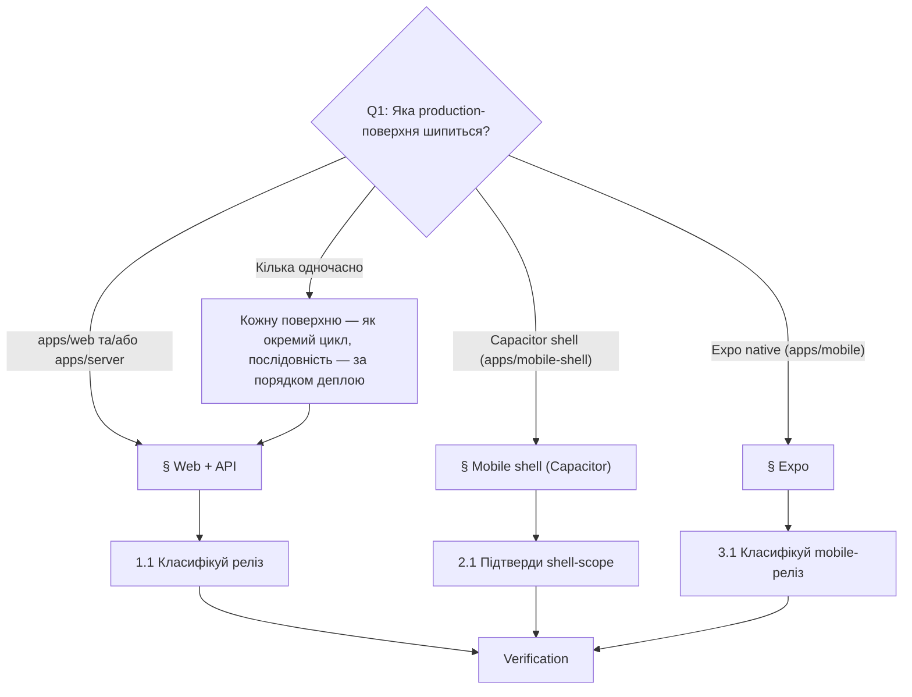

# Playbook: Реліз (release)

> **Last validated:** 2026-05-05 by @Skords-01. **Next review:** 2026-08-04.
> **Status:** Active

**Trigger:** виливай зміну, що несе реліз, на будь-яку production-поверхню — `apps/web`, `apps/server`, `apps/mobile-shell` (Capacitor) або `apps/mobile` (Expo). Включає EAS-апдейти, store-builds і скоординовані cross-surface деплої.

## Owner surface

- Primary surface: production deploy pipeline через web/API, mobile shell і Expo
- Coupled surfaces: `apps/server`, `apps/web`, `apps/mobile-shell`, `apps/mobile`
- Governing skill: `sergeant-deploy-and-observability`

## Required context

- Почни з `sergeant-start-here`, потім завантаж `sergeant-deploy-and-observability` (web/API і Capacitor) або `sergeant-mobile-expo` (Expo).
- Переглянь [release-policy.md](../governance/release-policy.md) для таксономії merge-only / coordinated / high-risk.
- Переглянь [service-catalog.md](../architecture/service-catalog.md) для rollback-шляху і tier-у зачепленої поверхні.
- Переглянь [platforms.md](../architecture/platforms.md), коли зміна перетинає Capacitor або Expo.
- Якщо у грі міграція, додатково відкрий [add-sql-migration.md](./add-sql-migration.md).

## Decision tree — яку поверхню ти релізиш?

Якщо зміна docs-only або internal-only без runtime-ефекту, цей playbook не застосовується — продовжуй звичайним merge.

## 1. Web + API

Для скоординованих `apps/web` + `apps/server` деплоїв.

### 1.1 Класифікуй реліз

- Визнач, чи зміна merge-only, coordinated або high-risk за [release-policy.md](../governance/release-policy.md).
- Назви зачеплені поверхні і deploy-таргети у PR.
- Підтверди rollback-шлях ще до merge.

### 1.2 Зафіксуй порядок деплою

- Викочуй env-зміни перед кодом — лише якщо нові значення backward-compatible.
- Викочуй міграції перед app-деплоєм — лише коли schema-зміна аддитивна і backward-compatible.
- Деплой API перед web, якщо UI залежить від нової поведінки контракту.
- Деплой web перед API — лише коли API повністю backward-compatible і UI — ризикова поверхня.

### 1.3 Перевір release-gates

- CI на змінених поверхнях зелений.
- Немає блокувального інциденту або червоного error-budget на тому ж dependency-chain — крім випадку, коли цей реліз і є мітигація.
- Feature flags і kill switches задокументовані.

### 1.4 Виконай деплой

- Мерджь свідомо.
- Деплой у задокументованому порядку.
- Запиши deployment ID або release-референси, що використані.

### 1.5 Прогон post-release-верифікації

- Перевір `/health` і один user-critical flow end-to-end.
- Перевір error rates, latency і Sentry-шум на змінених поверхнях.
- Підтверди, що стан feature flag відповідає rollout-плану.

## 2. Mobile shell (Capacitor)

Для `apps/mobile-shell` builds, store-метаданих або поведінки native-врапера.

### 2.1 Підтверди shell-scope

- Відокрем shell-only зміни від змін у вбудованому web-білді.
- Якщо web-артефакт теж змінився — спершу пройди § Web + API, щоб виливати base web-build.
- Підтверди, чи треба шипити iOS, Android або обидва.

### 2.2 Підготуй release notes і rollback

- Запиши build-номери і version-bump.
- Задокументуй store-lane, варіант staged rollout-у і референс попереднього стабільного білду.
- Перевір, чи якийсь feature flag або server-side kill switch може зменшити blast-radius.

### 2.3 Збери і подай

- Зроби release-candidate білд.
- Прогони smoke на install, launch, auth bootstrap і один критичний deep-link або notification path.
- Подай у потрібний store lane або internal track.

### 2.4 Post-release-верифікація

- Підтверди availability в цільовому lane.
- Прогони install/open smoke на опублікованому білді.
- Моніторь crash- і auth-сигнали після старту rollout-у.

## 3. Expo

Для `apps/mobile` builds, EAS updates або release-channel змін.

### 3.1 Класифікуй mobile-реліз

- Визнач, це OTA/channel update, новий build чи обидва.
- Підтверди, чи реліз залежить від нової API-поведінки або feature flags.

### 3.2 Підготуй rollout

- Зафіксуй build- або update-ідентифікатори.
- Запиши target channel, cohort і метод rollback-у.
- Переконайся, що auth bootstrap і один mobile-only flow — у smoke-плані.

### 3.3 Виконай реліз

- Шипи build або update у потрібний lane.
- Перевір, що використано правильні config/env.
- Якщо реліз залежить від server-змін, спершу пройди § Web + API для API-частини.

### 3.4 Перевір і моніторь

- Встанови або онови опублікований артефакт.
- Прогони auth, один primary-screen load і одну mobile-only взаємодію.
- Стеж за crash/error-сигналами і support-feedback-ом під час rollout-у.

## Verification

- [ ] Primary surface названа у PR
- [ ] Порядок деплою задокументований, коли задіяно більше ніж одну поверхню
- [ ] Rollback-шлях задокументований (web/API: попередній Vercel/Railway deploy; shell: попередній store-build; Expo: попередній channel-update)
- [ ] Post-release smoke виконано для зачепленої поверхні (`/health` + critical flow для web/API; install + auth для shell; auth + один mobile-only flow для Expo)
- [ ] Будь-який порядок міграції/env-у зафіксовано в PR або release-note
- [ ] Build/version/channel-ідентифікатори записано для mobile-релізів

## Коли цей playbook НЕ використовувати

- Зміна docs-only або internal-only без runtime-ефекту.
- Production-регресія, що потребує негайного hotfix → [hotfix-prod-regression.md](./hotfix-prod-regression.md).
- Чисте retirement feature-flag-у без code-змін → [retire-feature-flag.md](./retire-feature-flag.md).

## Споріднені playbook-и та skills

- [hotfix-prod-regression.md](./hotfix-prod-regression.md)
- [add-sql-migration.md](./add-sql-migration.md) — коли реліз шипить schema-зміни.
- [port-web-screen-to-mobile.md](./port-web-screen-to-mobile.md) — коли реліз піднімає web-flow у Expo.
- Skill: `sergeant-deploy-and-observability`
- Skill: `sergeant-server-api`
- Skill: `sergeant-web-ui`
- Skill: `sergeant-mobile-expo`
